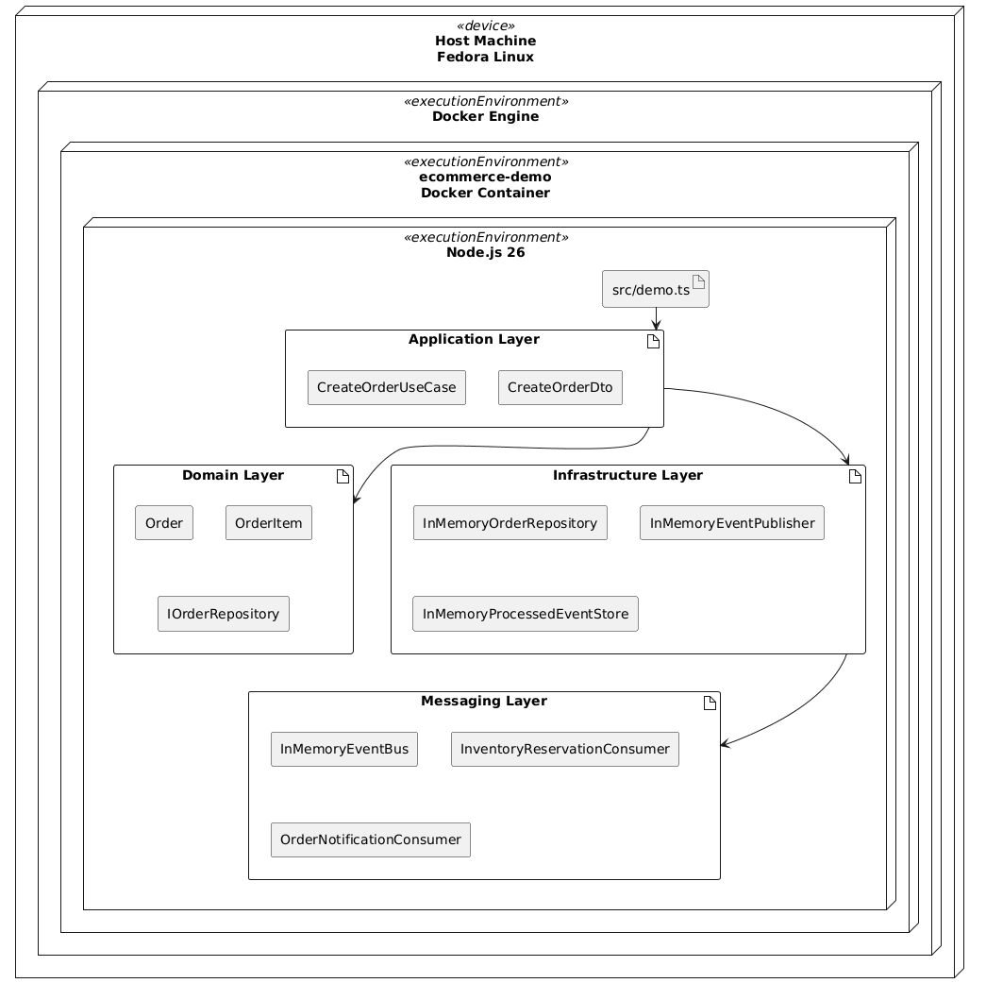

# Architectural Design Document (ADD)

## Система: E-Commerce Cloud Platform (High-Load Marketplace)

**Студент:** Ковальчук Д.С.  
**Група:** 3ПР1
**Тег у репозиторії:** `lr6`

---

### 1. Вступ та цілі системи

#### 1.1. Призначення системи

E-Commerce Cloud Platform - це архітектурний проєкт платформи електронної комерції, призначеної для організації процесів онлайн-торгівлі. Система передбачає роботу з каталогом товарів, кошиком покупця, оформленням замовлень, обробкою платежів, резервуванням товарів та надсиланням сповіщень. Основною метою проєкту є розроблення архітектури програмної системи, яка може масштабуватися відповідно до зростання навантаження, підтримувати незалежність бізнес-логіки від інфраструктурних компонентів та забезпечувати надійну обробку операцій. У межах наскрізного проєкту послідовно розглянуто архітектурні представлення системи, нефункціональні вимоги, API-контракти, принципи Clean Architecture, обмін подіями та фізичне розгортання.

#### 1.2. Основні цілі

До основних цілей системи належать:

- забезпечення централізованого керування каталогом товарів;
- підтримка створення та обробки замовлень;
- забезпечення взаємодії між функціональними модулями;
- підтримка подієвої взаємодії між компонентами;
- запобігання повторній обробці однакових подій;
- забезпечення можливості подальшого масштабування;
- розділення бізнес-логіки та інфраструктурних залежностей;
- забезпечення тестованості та супроводжуваності програмного забезпечення.

#### 1.3. Межі поточної реалізації

Необхідно розрізняти цільову архітектуру платформи та реалізований демонстраційний прототип. Цільова архітектура передбачає функціональні області каталогу, кошика, замовлень, платежів, інвентаризації та сповіщень. Поточна демонстраційна реалізація зосереджена на сценарії створення замовлення та подальшій обробці події `OrderCreatedEvent`. Для цього використовуються TypeScript, Node.js, Clean Architecture, контейнер залежностей Awilix та власна реалізація механізму обміну подіями в пам'яті. Поточна версія запускається як один процес у Docker-контейнері. Вона не є повноцінною розподіленою системою мікросервісів.

---

### 2. Архітектурні обмеження та NFR (ISO 25010)

#### 2.1. Архітектурні обмеження

Під час проєктування системи враховано такі обмеження:

1. Технологічні обмеження. Основна реалізація виконується мовою TypeScript із використанням платформи Node.js.
2. Архітектурні обмеження. Бізнес-логіка відокремлена від інфраструктурних механізмів відповідно до принципів Clean Architecture.
3. Організація коду. Функціональність розподілена між шарами Domain, Application, Infrastructure та WebAPI.
4. Обмін подіями. Для демонстраційної реалізації використовується власний in-memory Event Bus.
5. Зберігання даних. У поточній демонстраційній версії застосовується InMemoryOrderRepository.
6. Розгортання. Запуск демонстраційної версії виконується через Docker та Docker Compose.
7. Тестування. Для перевірки бізнес-логіки використовуються Vitest і TypeScript Compiler.

#### 2.2. Нефункціональні вимоги

Нефункціональні вимоги сформовано з урахуванням характеристик якості ISO/IEC 25010.

| Характеристика    | Вимога                                            | Цільове значення                                                 |
| ----------------- | ------------------------------------------------- | ---------------------------------------------------------------- |
| Продуктивність    | Час відповіді пошуку каталогу                     | p95 ≤ 150 мс при 1000 RPS                                        |
| Продуктивність    | Обробка створення замовлень                       | до 3000 RPS у піковому режимі                                    |
| Надійність        | Частка успішних запитів створення замовлення      | відсутність HTTP 5xx у межах заданого навантажувального сценарію |
| Доступність       | Доступність системи                               | 99,9%                                                            |
| Безпека           | Захист даних під час передавання                  | TLS 1.3                                                          |
| Безпека           | Захист даних у сховищі                            | AES-256                                                          |
| Супроводжуваність | Покриття модульними тестами Domain та Use Case    | не менше 80%                                                     |
| Масштабованість   | Автоматичне масштабування обчислювальних ресурсів | HPA при CPU > 70% протягом 2 хвилин                              |

Наведені значення є цільовими архітектурними показниками. Вони не означають, що поточна демонстраційна реалізація вже пройшла відповідні навантажувальні та безпекові випробування.

#### 2.3. Відповідність ISO/IEC 25010

Продуктивність (Performance Efficiency). Архітектура передбачає оптимізацію обробки запитів та можливість масштабування компонентів відповідно до навантаження.

Надійність (Reliability). Для подієвої взаємодії передбачено ізоляцію помилок обробників та механізм ідемпотентності, який запобігає повторній обробці вже опрацьованих подій.

Безпека (Security). Цільова архітектура передбачає захищене передавання даних, контроль доступу та використання механізмів автентифікації.

Супроводжуваність (Maintainability). Поділ системи на архітектурні шари дозволяє змінювати інфраструктурні компоненти без безпосереднього втручання в основну бізнес-логіку.

Переносимість (Portability). Використання Docker забезпечує відтворюване середовище запуску демонстраційної версії.

---

### 3. Контекст та межі системи (C4 Level 1)

#### 3.1. Контекст системи

E-Commerce Cloud Platform взаємодіє з користувачами та зовнішніми системами, необхідними для функціонування платформи електронної комерції.

Основними зовнішніми акторами та системами цільової архітектури є:

- Покупець - переглядає каталог, формує кошик та створює замовлення.
- Адміністратор - керує каталогом та контролює роботу платформи.
- Платіжний провайдер - забезпечує обробку платіжних операцій.
- Сервіс електронної пошти - використовується для надсилання повідомлень користувачам.

Ці взаємодії описують функціональні межі цільової системи. У поточній демонстраційній реалізації інтеграції із зовнішнім платіжним провайдером та поштовим сервісом не реалізовані.

#### 3.2. Межі системи

У межах платформи виділяються такі функціональні області:

- Catalog - керування товарами та каталогом.
- Cart - робота з кошиком покупця.
- Order - створення та обробка замовлень.
- Payment - обробка платіжних операцій.
- Inventory - резервування товарів.
- Notification - формування сповіщень.

Поточний програмний прототип реалізує обмежений наскрізний сценарій навколо модуля Order та подієвих обробників Inventory і Notification.

---

### 4. Архітектурна стратегія та ADR

#### 4.1. Обрана архітектурна стратегія

Для організації програмної структури використано принципи Clean Architecture. Основна ідея полягає в розділенні бізнес-правил, сценаріїв використання та інфраструктурних механізмів.

У поточній реалізації виділено такі шари:

- Domain Layer - містить основні бізнес-сутності, об'єкти значень та інтерфейси репозиторіїв.
- Application Layer - містить сценарії використання та DTO.
- Infrastructure Layer - реалізує репозиторії, обробники подій та механізми обміну повідомленнями.
- WebAPI Layer - містить контролер та контейнер залежностей.

Залежності організовано таким чином, щоб бізнес-логіка не залежала безпосередньо від конкретних інфраструктурних реалізацій.Для керування залежностями використовується Awilix.

#### 4.2. Архітектурні рішення

**ADR-0001 — Вибір архітектурного стилю**

Контекст: система повинна мати чітко визначені межі функціональних компонентів, залишатися зручною для розроблення та тестування і підтримувати можливість подальшого розвитку.

Розглянуті альтернативи:

- монолітна багатошарова архітектура;
- модульний моноліт із Clean Architecture;
- мікросервісна архітектура.

Рішення: використати модульний підхід із принципами Clean Architecture.

Наслідки: бізнес-логіка відокремлюється від інфраструктури, спрощується модульне тестування та підтримується можливість подальшого виділення окремих сервісів. Водночас необхідно контролювати залежності між модулями.

**ADR-0002 — Стратегія зберігання даних**

Контекст: платформа повинна зберігати інформацію про товари, користувачів та замовлення.

Розглянуті альтернативи:

- реляційна база даних;
- документно-орієнтована база даних;
- зберігання даних у пам'яті для демонстраційної реалізації.

Рішення: у демонстраційній версії використати InMemoryOrderRepository через інтерфейс репозиторію. Для цільової системи передбачено можливість використання реляційного сховища, зокрема PostgreSQL. Наслідки: поточна реалізація не потребує окремого сервера бази даних, але дані не зберігаються після завершення процесу. Перехід на постійне сховище потребуватиме реалізації відповідного адаптера репозиторію.

**ADR-0003 — Стратегія автентифікації та безпеки**

Контекст: платформа повинна забезпечувати контроль доступу до функцій та захист даних користувачів.

Розглянуті альтернативи:

- власна реалізація механізмів автентифікації;
- використання JWT;
- використання зовнішнього провайдера ідентифікації з підтримкою OAuth 2.0 / OpenID Connect.

Рішення: цільова архітектура передбачає використання централізованого механізму ідентифікації з підтримкою стандартних протоколів автентифікації та авторизації. Наслідки: централізоване керування доступом спрощує інтеграцію з функціональними модулями. Поточна демонстраційна версія не реалізує повноцінний механізм автентифікації.

**ADR-0004 — Вибір топології розгортання**

Контекст: необхідно визначити спосіб розгортання та запуску поточної демонстраційної реалізації.

Розглянуті альтернативи:

- запуск застосунку без контейнеризації;
- запуск одного контейнера з усіма компонентами;
- розгортання окремих контейнерів для кожного функціонального модуля.

Рішення: для поточної версії обрано один Docker-контейнер із середовищем Node.js 26 Alpine. Запуск організовано через Docker Compose.

Наслідки: конфігурація розгортання залишається простою та відтворюваною. Усі компоненти працюють в одному процесі, тому незалежне масштабування окремих функціональних областей не підтримується.

---

### 5. Структурні діаграми

#### 5.1. C4 Container Diagram (Level 2)

#### 5.2. UML Component Diagram

### 6. Динаміка взаємодії

#### 6.1. Сценарій створення замовлення

Основний наскрізний сценарій демонстраційної реалізації починається зі створення замовлення через `CreateOrderController`. Контролер передає дані до `CreateOrderUseCase`, який перевіряє отримані дані, створює доменну сутність замовлення та зберігає її через інтерфейс `IOrderRepository`. Після успішного збереження замовлення публікується подія `OrderCreatedEvent`. Подія передається до `InMemoryEventBus`, який доставляє її підписаним обробникам:

- `InventoryReservationConsumer` - обробляє подію та виконує демонстрацію резервування товарів;
- `OrderNotificationConsumer` - обробляє подію та формує демонстраційне сповіщення.

Таким чином, створення замовлення та подальші реакції на нього логічно відокремлені.

#### 6.2. Ідемпотентність обробки подій

Для запобігання повторній обробці однакових подій використовується `InMemoryProcessedEventStore`. Кожна подія має унікальний ідентифікатор `eventId`. Обробник перевіряє, чи була подія вже опрацьована. Якщо ідентифікатор присутній у сховищі оброблених подій, повторна обробка пропускається. Цей механізм дозволяє демонструвати ідемпотентність споживачів подій. Важливо, що поточне сховище оброблених подій є тимчасовим і працює в пам'яті процесу. Після перезапуску застосунку його стан втрачається.

#### 6.3. Обробка помилок

Реалізація `InMemoryEventBus` передбачає ізоляцію помилок окремих обробників. Помилка одного споживача не повинна автоматично переривати доставку події іншим споживачам. Для демонстраційного сценарію передбачено очікування завершення асинхронних обробників за допомогою методу `waitForIdle()`.

#### 6.4. UML Sequence Diagram

#### 6.5. API та контракти взаємодії

У межах попередніх етапів проєкту підготовлено специфікації REST API у форматі OpenAPI та контракт gRPC із використанням Protocol Buffers.

Файли специфікацій:

- `api/openapi.yaml` - опис REST API;
- `api/service.proto` - опис gRPC-сервісу.

REST API використовує формат JSON для обміну даними. Для стандартизації опису помилок передбачено підхід RFC 7807. gRPC-контракт використовує Protocol Buffers, що дозволяє передавати структуровані повідомлення у бінарному форматі. Ці специфікації є частиною проєктної архітектури. Вони не означають, що поточний Docker Demo запускає HTTP-сервер або gRPC-сервер.

---

### 7. Фізична архітектура (UML Deployment Diagram)

#### 7.1. Середовище розгортання

Поточна демонстраційна версія системи розгортається на хостовій машині під керуванням Fedora Linux. Для контейнеризації використовується Docker Engine, а для опису запуску контейнера - Docker Compose. Docker-образ створюється на базі `node:26-alpine`. У контейнер копіюються файли `package.json`, `package-lock.json`, `tsconfig.json` та каталог `src`.

Після встановлення залежностей запускається команда:

`npm run demo`

Точка входу демонстраційного сценарію — `src/demo.ts`.

#### 7.2. Топологія розгортання

Фізична структура поточної версії включає:

1. Хостову машину з операційною системою Fedora Linux.
2. Docker Engine як середовище контейнеризації.
3. Контейнер `ecommerce-demo`.
4. Середовище виконання Node.js 26 Alpine.
5. Програмні компоненти Application, Domain, Infrastructure та Messaging.

Усі компоненти застосунку виконуються в межах одного процесу. Для взаємодії між ними не використовуються зовнішні мережеві з'єднання.

#### 7.3. UML Deployment Diagram

#### 7.4. Конфігурація Docker Compose

Для автоматизації розгортання використовується файл `docker-compose.yml`. У ньому описано сервіс `ecommerce-demo`, який збирається з Dockerfile у корені репозиторію.Для контейнера встановлено політику `restart: "no"`, оскільки він виконує одноразовий демонстраційний сценарій та завершує роботу після його виконання. Поточна конфігурація не передбачає відкриття мережевих портів, оскільки HTTP-сервер у демонстраційному застосунку не запускається.

#### 7.5. Результати перевірки розгортання

Під час перевірки було виконано побудову Docker-образу та запуск контейнера за допомогою Docker Compose.

У результаті:

- Docker-образ успішно побудовано;
- контейнер `ecommerce-demo` успішно запущено;
- сценарій створення замовлення виконано;
- обидва обробники отримали подію створення замовлення;
- повторна доставка тієї самої події була пропущена завдяки механізму ідемпотентності;
- контейнер завершив роботу з кодом 0.

Додатково виконано перевірку типів командою `tsc --noEmit` та модульні тести за допомогою Vitest. Усі три наявні тести пройшли успішно. Лог демонстраційного запуску збережено у файлі `docs/lr6/e2e_demo.log`.

---

### 8. Компроміси та ризики

#### 8.1. Архітектурні компроміси

Під час розроблення системи прийнято низку рішень, які мають як переваги, так і обмеження.

**Модульна структура замість окремих мікросервісів.**

Використання єдиного процесу спрощує розроблення, тестування та демонстрацію системи. Водночас функціональні області не можуть незалежно масштабуватися або розгортатися.

**In-memory сховище замість постійної бази даних.**

`InMemoryOrderRepository` дозволяє демонструвати роботу бізнес-логіки без налаштування окремої бази даних. Недоліком є втрата даних після завершення процесу.

**In-memory Event Bus замість зовнішнього брокера повідомлень.**

Власна реалізація Event Bus демонструє принципи подієвої взаємодії, ізоляцію обробників та ідемпотентність. Проте вона не забезпечує міжпроцесний обмін повідомленнями, збереження черги та доставку подій між незалежними вузлами.

**Один Docker-контейнер замість розподіленого розгортання.**

Контейнеризація спрощує відтворення середовища та запуск демонстраційної версії. Водночас відсутня можливість незалежного масштабування окремих функціональних компонентів.

#### 8.2. Основні ризики

| Ризик                                                    | Наслідок                                                          | Можливий напрям усунення                |
| -------------------------------------------------------- | ----------------------------------------------------------------- | --------------------------------------- |
| Втрата даних у пам'яті                                   | Дані зникають після перезапуску                                   | Підключення постійного сховища          |
| Втрата стану ідемпотентності                             | Повторна обробка подій після перезапуску                          | Постійне сховище ідентифікаторів подій  |
| Відсутність зовнішнього брокера                          | Неможливість обміну подіями між окремими процесами                | Інтеграція з брокером повідомлень       |
| Єдиний процес                                            | Неможливість незалежного масштабування модулів                    | Виділення окремих сервісів за потреби   |
| Відсутність реалізованої автентифікації                  | Немає повноцінного контролю доступу в демонстраційному застосунку | Інтеграція з провайдером ідентифікації  |
| Відсутність навантажувальних випробувань поточної версії | Немає підтвердження досягнення цільових показників продуктивності | Проведення навантажувального тестування |

#### 8.3. Подальший розвиток

Подальший розвиток системи може передбачати:

- заміну InMemoryOrderRepository на постійне сховище даних;
- використання зовнішнього брокера повідомлень;
- реалізацію повноцінних REST та gRPC серверів;
- додавання механізмів автентифікації та авторизації;
- реалізацію інтеграції з платіжними та поштовими провайдерами;
- створення окремих процесів для функціональних сервісів;
- впровадження моніторингу та автоматичного масштабування;
- проведення навантажувального тестування відповідно до визначених NFR.

Таким чином, поточна реалізація є демонстраційною основою для подальшого розвитку архітектури E-Commerce Cloud Platform.
